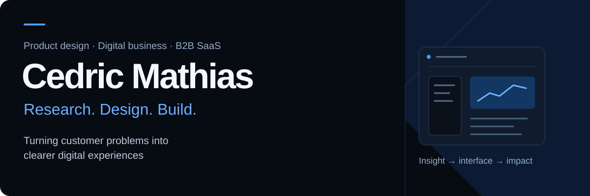
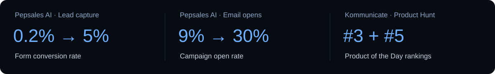

<!-- Profile design: black, ink blue and electric blue. Native Markdown keeps the content accessible. -->

  <a href="https://cedricmathias1.github.io/"><strong>Explore my portfolio ↗</strong></a>
  &nbsp; / &nbsp;
  <a href="#selected-work">Selected work</a>
  &nbsp; / &nbsp;
  <a href="https://www.linkedin.com/in/cedric-mathias/">LinkedIn</a>
  &nbsp; / &nbsp;
  <a href="mailto:cedricmathias1@gmail.com">Get in touch</a>

<table>
<tr>
<td width="72%" valign="middle">

### Customer insight, made tangible

I'm Cedric, an **MSc Design & Development of Digital Business graduate from University College Cork**, with experience in B2B SaaS product marketing.

I connect research, interface design and commercial thinking: understanding the problem, prototyping the experience and building the front end.

**Open to opportunities across Ireland** in product and UX design, business analysis, digital business and product marketing.

</td>
<td width="28%" align="center" valign="middle">

</td>
</tr>
</table>

## Selected work

Three different problems. One thread: make the next action clearer.

<table>
<tr>
<td width="33%" valign="top">

**01 / Musgrave · Frank & Honest**

### Making reuse a daily habit

A reusable-cup loyalty experience across **three connected app prototypes**. UCC team capstone with Musgrave.

**My contribution**  
Research framing, persona development, Figma prototyping and contributions to the coded MVP.

**Working MVP & pilot proposal**

[Read the case study ↗](https://cedricmathias1.github.io/musgrave.html)

</td>
<td width="33%" valign="top">

**02 / Drip · Circular fashion**

### Giving clothes a second chapter

A **12-week service-design project** exploring repair, resale and product transparency in fashion retail.

**My contribution**  
Research and persona lead, product-passport concept and co-leading the Figma prototype.

**High-fidelity service concept**

[Read the case study ↗](https://cedricmathias1.github.io/drip.html)

</td>
<td width="33%" valign="top">

**03 / USCH · Student experience**

### Bringing student life into focus

A unified dashboard for academic messages, deadlines and resources, informed by **eight interviews**.

**My contribution**  
End-to-end UX research, empathy mapping, dashboard design and moderated prototype testing.

**Tested Figma prototype**

[Read the case study ↗](https://cedricmathias1.github.io/usch.html)

</td>
</tr>
</table>

<strong>Try the Musgrave team prototypes</strong>

Explore the connected loyalty experiences: [Frank & Honest](https://frank-and-honest-app.vercel.app) · [SuperValu](https://super-valu-app.vercel.app) · [My Centra](https://my-centra-app-cfl2-sigma.vercel.app).

These are project prototypes developed for the capstone and pilot proposal.

## Marketing work with measurable outcomes

**Pepsales AI · Product Marketing Associate**  
Landing-page UX and copy, segmented email campaigns and coordinated acquisition campaigns.

**Kommunicate · Associate Product Marketing Manager**  
Product positioning, Product Hunt launches, sales enablement and campaign analysis.

Reported campaign-period outcomes. Multiple campaign and product changes contributed; individual effects were not isolated.

## How I work

| Understand | Shape | Build | Learn |
| :--- | :--- | :--- | :--- |
| User interviews, customer needs and journey mapping | Personas, wireframes, service concepts and Figma prototypes | Responsive interfaces in HTML, CSS and JavaScript | Usability testing, funnel analysis and messaging improvements |

<strong>Tools & methods</strong>

| Area | Tools & methods |
| :--- | :--- |
| Research & design | Figma, user interviews, empathy maps, personas, journey mapping, usability testing |
| Front end | HTML, CSS, JavaScript, Git & GitHub |
| Product marketing | Positioning, messaging, go-to-market planning, sales enablement, lifecycle email |
| Measurement | GA4, Mixpanel, conversion optimisation, campaign analysis |
| CRM & email | HubSpot |

## From prototype to browser

**[Explore the portfolio source ↗](https://github.com/Cedricmathias1/cedricmathias1.github.io)**  
Responsive case studies and an interactive project gallery, built with HTML, CSS and JavaScript.

---

**Have a customer problem worth exploring?**  
[View my work](https://cedricmathias1.github.io/) · [Connect on LinkedIn](https://www.linkedin.com/in/cedric-mathias/) · [Email me](mailto:cedricmathias1@gmail.com)
